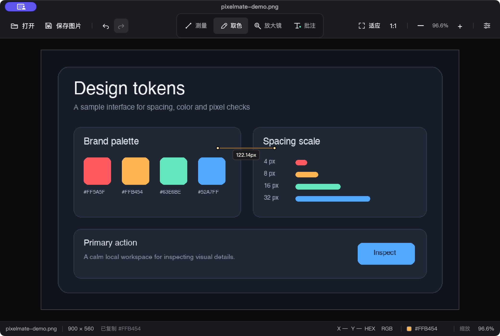

# PixelMate

**一张图，一把尺，一支吸管。**

PixelMate 是一款面向网页开发、UI 设计、切图和素材检查的轻量桌面工具。
它可以测量图片中的真实像素距离、读取原始像素颜色、放大检查细节，并在图片上添加
文字批注。测量和批注不会改写源文件，图片也始终留在本机。

> PixelMate is a privacy-first desktop image inspector for pixel-accurate
> measurement, color sampling, and annotation.



## 为什么用 PixelMate

- **直接量原图，不受缩放影响。** 测量结果基于图片原始像素坐标，缩放、平移或调整窗口
  都不会改变数值。
- **取到的是图片颜色，不是屏幕颜色。** 直接读取解码后的原始像素，透明和半透明 PNG
  不会因为显示混合而丢失颜色通道。
- **少切换一次软件。** 测量、取色、放大镜和批注都在同一个画布完成，随后可按原分辨率
  导出 PNG。
- **本地、离线、不上传。** 没有账号，没有云端处理，也不修改源图片。
- **桌面效率和键盘优先。** 常见操作都有快捷键，适合频繁检查和反复测量。

## 功能

### 像素测量

左键拖动即可测量原始图片中的两点距离。画布上实时显示总长度，同时保留水平距离、
垂直距离和起止坐标；按住 `Shift` 可锁定水平或垂直方向。支持保留多条测量线、复制全部
结果并撤销清空操作。

### 原始像素取色

悬停读取当前像素的颜色和坐标，单击复制 HEX。状态栏可分别复制 HEX 与 RGB；透明像素
显示八位 HEX 或 RGBA，颜色不会因为透明背景而失真。

### 像素放大镜

在指针附近显示最近邻放大视图，包含像素网格、中心准星和当前像素高亮，并提供
`8×`、`12×`、`16×` 三档倍率。浮层会根据窗口边缘自动换位。

### 文字批注

点击图片任意位置添加多行文字批注。批注锚定在原始图片坐标上，缩放和平移后仍与图片
保持相对位置，可复制或清除，并支持撤销与重做。

### 图片浏览与导出

支持通过文件选择器或拖放打开 `PNG`、`JPG`、`JPEG`、`BMP` 和 `WebP`。滚轮以指针为
中心缩放，中键拖动平移，按住空格可临时抓手。保存结果不受当前窗口尺寸影响，始终按
原图分辨率将测量线和批注合成为 PNG。

### 轻量且可恢复

- 图片在后台线程解码，连续打开时只应用最后一次请求。
- 损坏或不支持的图片会显示错误提示，并保留当前图片。
- 单张图片限制为边长不超过 `32767px`、总像素不超过 `6400 万`。
- 设置和撤销历史在本地保存或维护，不依赖网络服务。

## 快速开始

### macOS 源码运行

当前 macOS 开发目标为 Apple Silicon，要求 macOS 15+ 和 .NET SDK 10。

```sh
git clone https://github.com/xjgd233/PixelMate.git
cd PixelMate
./scripts/run-macos.sh Release
```

如果 .NET SDK 安装在 `~/.dotnet`，脚本会自动使用该位置。也可以手动运行：

```sh
export PATH="$HOME/.dotnet:$PATH"
dotnet restore PixelMate.slnx
dotnet run --project src/PixelMate/PixelMate.csproj
```

### 基本操作

1. 按 `⌘O` / `Ctrl+O` 打开图片，或直接把图片拖进窗口。
2. 按 `M` 拖动测量，按 `I` 取色，按 `Z` 检查像素，按 `T` 添加批注。
3. 按 `⌘S` / `Ctrl+S` 将当前图片、测量线和批注导出为 PNG。

## 快捷键

| 操作 | macOS | Windows |
| --- | --- | --- |
| 打开图片 | `⌘O` | `Ctrl+O` |
| 保存处理后的图片 | `⌘S` | `Ctrl+S` |
| 撤销 / 重做 | `⌘Z` / `⌘⇧Z` | `Ctrl+Z` / `Ctrl+Y` |
| 测量 | `M` | `M` |
| 取色 | `I` | `I` |
| 放大镜 | `Z` | `Z` |
| 批注 | `T` | `T` |
| 临时抓手 | 按住空格拖动 | 按住空格拖动 |
| 适应窗口 / 100% | `⌘0` / `⌘1` | `Ctrl+0` / `Ctrl+1` |
| 缩放 | `⌘+` / `⌘-` | `Ctrl++` / `Ctrl+-` |
| 复制当前结果 | `⌘C` | `Ctrl+C` |
| 调整放大镜倍率 | `[` / `]` | `[` / `]` |
| 清除当前工具结果 | `⌫` | `Delete` / `Backspace` |

测量时按住 `Shift` 可锁定水平或垂直方向。

## 平台状态

| 平台 | 当前状态 |
| --- | --- |
| macOS ARM64 | 已完成实际窗口功能测试；可从源码运行 |
| Windows x64 | Windows 实机核心功能通过；字体显示修正待复验 |

当前仓库尚未提供正式公开下载包。Windows 用户可按下方命令自行构建；未签名程序可能
被 Windows SmartScreen 或智能应用控制拦截。

## 构建与测试

要求 .NET SDK `10.0.403` 或同一 10.0 feature band 的更新版本。

```sh
dotnet restore PixelMate.slnx
dotnet build PixelMate.slnx -c Release
dotnet test PixelMate.slnx -c Release
```

当前自动化测试覆盖坐标转换、测量公式、颜色与 Alpha 处理、放大镜布局、图片边界、
偏好设置、撤销历史和导出参数。

### Windows x64 构建

macOS：

```sh
./scripts/publish-windows-x64.sh
```

Windows PowerShell：

```powershell
.\scripts\publish-windows-x64.ps1
```

输出为 `win-x64`、Release、自包含发布包。相关说明见
[Windows 离线包](docs/windows-offline-package.md)和
[Windows 验收清单](docs/windows-acceptance-checklist.md)。

## 技术栈

PixelMate 使用 C#、.NET 10、Avalonia UI、Skia 和 xUnit 构建。同一套代码面向
macOS ARM64 与 Windows x64，不依赖 Electron、数据库、后台服务或云端图片处理。

## 反馈与交流

遇到问题或有功能建议，可以通过
[GitHub Issues](https://github.com/xjgd233/PixelMate/issues) 反馈。提交问题时附上
操作系统、图片格式和复现步骤会更容易定位。

作者：笑脸152 · [GitHub](https://github.com/xjgd233)
